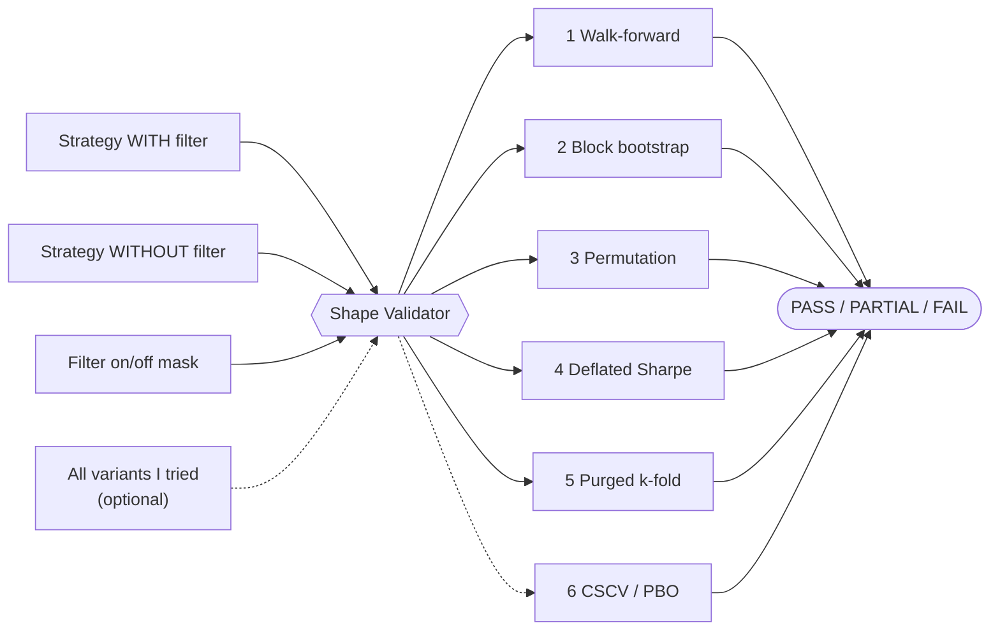

<div align="center">

# 📐 Shape Validator

## Geometry, not poetry.

### Six independent tests that decide whether a backtested edge is real or just luck

[](https://www.python.org/)
[](LICENSE)
[](tests/test_smoke.py)
[](pyproject.toml)

*You have a rule that improves a strategy. The backtest says it works. This tells you whether to believe it.*

[Why I built it](#-why-i-built-it) •
[How it works](#-how-it-works) •
[User guide](#-user-guide) •
[Reading the verdict](#-reading-the-verdict) •
[What it will not do](#%EF%B8%8F-what-it-will-not-do-for-you)

</div>

---

## 🎯 Why I built it

I have built and tested many trading strategies — roughly a hundred candidates, most of them
filters ("only trade when X is true") laid on top of an existing strategy. Almost every one of them
looked good in its backtest. Almost none of them were real.

The problem was never a lack of statistical tests. Walk-forward analysis, the bootstrap, the deflated
Sharpe ratio, purged cross-validation — all of these are published and well understood. The problem was
that I ran them **one at a time, when I remembered to, and stopped at the first one that agreed with
me**.

So I wired six of them together behind one function call, with one verdict scheme, and made each one
hard to skip.

**Why "shape": geometry, not poetry.** A backtest tells a story. I don't trade stories; I trade
shapes. A real edge has a geometry you can measure:

- it **keeps its shape** in every slice of time the tests cut it into (walk-forward folds, purged folds,
  half-and-half splits);
- its **mirror image points the other way**: when the filter's condition is reversed, the effect flips sign;
- it **holds when the tempo changes**: same rule, different market regime, same direction of effect.

Noise has no shape to keep. The six tests measure the first point; the mirror and tempo checks are
what I do before I run them (see the note in `validator.py`).

> [!NOTE]
> Nothing here is new statistics. It is an assembly of published methods — Pardo's walk-forward,
> López de Prado's purged k-fold and deflated Sharpe ratio, Bailey–Borwein–López de Prado–Zhu's CSCV,
> the block bootstrap, and a permutation test. The value is in running all of them, every time, the
> same way.

---

## 🧠 How it works

You give it two daily return series — your strategy **with** the filter and **without** it — plus the
on/off mask that says when the filter was active. Each test asks a different question about the
difference between them:



| # | Test | The question it answers | In plain words | Source |
|:-:|---|---|---|---|
| 1 | **Walk-forward** | Does it hold in periods it was not fitted on? | Split time into folds; the filter must help in most of them, not just overall. | Pardo |
| 2 | **Block bootstrap CI** | Does the improvement's confidence interval exclude zero? | Resample the history in 14-day blocks (so streaks stay intact) thousands of times; the gain must stay above zero. | Künsch / Politis–Romano |
| 3 | **Permutation** | Does it beat the same rule with its timing shuffled? | Keep the same number of "on" days but put them at random dates. If random timing does as well, the timing is not the edge. | Fisher / Good |
| 4 | **Deflated Sharpe** | Does it survive being one of *N* things I tried? | The best of 20 random rules always looks good. This raises the bar by how many rules I tested. | Bailey & López de Prado 2014 |
| 5 | **Purged k-fold + embargo** | Does it hold once train/test leakage is removed? | Folds with a gap between them, so yesterday's data cannot leak into tomorrow's test. | *AFML* ch. 7 |
| 6 | **CSCV / PBO** | Is the *way I chose* this variant overfit? | Across every half/half split of history: does the variant that wins in one half rank above median in the other? | Bailey–Borwein–LdP–Zhu 2014 |

### Scoring

| Verdict | Rule | What I do with it |
|---|---|---|
| ✅ **PASS** | Every test that ran passed (5 of 5, or 6 of 6) | Strongest evidence. Ship it — to paper trading first. |
| 🟡 **PARTIAL** | At least 3 passed | Not proven. Noise lands here about 1 time in 4. Find out which test failed and why before trusting it. |
| ❌ **FAIL** | Fewer than 3 passed | Not distinguishable from luck. Park it. |

Test 6 only runs when you pass `cohort_returns` with **four or more** variants. **Pass it whenever you
can.** It is the only test that catches overfitting of the *choice* rather than the parameters, and in
my experience it is the one that most often disagrees with the other five.

### Two optional extras

<details>
<summary><b>🛡️ Risk axis (<code>RiskSpec</code>) — a veto for VaR/ES sizing rules</b></summary>

<br/>

The six tests validate *return* edge. They say nothing about whether a sizing rule's risk estimate is
calibrated. If your rule sizes positions from a VaR or Expected Shortfall number, pass a `RiskSpec` and
the validator also runs:

- **Kupiec POF** — do losses breach the VaR as often as they should (1% of days at 99%)?
- **Christoffersen** — are the breaches independent, or do they cluster?
- **ES exceedance test** — when the VaR is breached, is the average loss what the ES promised?
- **PIT / Berkowitz** (optional, needs `pred_draws`) — is the whole predicted distribution right?

It does **not** add to the pass count. It is a **veto**: a risk FAIL caps a clean PASS at PARTIAL.
I never size on a mis-calibrated risk number.

</details>

<details>
<summary><b>🧩 CPCV (<code>run_cpcv=True</code>) — is the edge continuous or episodic?</b></summary>

<br/>

Report-only; it never changes `overall`. The single walk-forward path in test 1 can survive by luck.
CPCV re-measures the gain across combinatorial leave-k-out sub-periods and reports:

| Result | Meaning |
|---|---|
| `ROBUST` | The gain shows up across almost every combination of periods. |
| `MODERATE` | Mostly there, with weak patches. |
| `CONCENTRATED` | The gain lives in a few periods. Treat it as an episodic effect, not a continuous one. |

</details>

---

## 📘 User guide

### 1. Install

```bash
git clone https://github.com/DonMilane/shape-validator
cd shape-validator
pip install -e .
pytest -q tests/            # noise, a tiny edge and a clear edge; the validator must tell them apart
python examples/quickstart.py
```

Requires Python 3.10+, numpy, pandas and scipy. Nothing else.

### 2. Prepare three inputs

All three are pandas Series on a **daily `DatetimeIndex`**. Rows are aligned on the dates the two
return series share.

| Input | What it is | Example |
|---|---|---|
| `with_daily` | Daily returns of the strategy **with** the filter applied | `0.004` = +0.4% that day |
| `without_daily` | Daily returns of the **same** strategy with the filter off | the baseline |
| `gate_mask` | `True` on days the filter was active, `False` otherwise | `rsi < 30` |

> [!IMPORTANT]
> The mask must be **causal**: on day *t* it may only use information known at the close of day *t − 1*
> (or the close of *t* if you act at the next bar). A mask built with future data passes every test here
> and is still worthless. The validator cannot detect look-ahead; only you can.

### 3. Run it

```python
from shape_validator import shape_validate

verdict = shape_validate(
    gate_label="my_filter",
    with_daily=returns_with_filter,
    without_daily=returns_without_filter,
    gate_mask=filter_on_off,
    n_total_candidate_gates=12,     # every variant I tried, not just the ones I liked
    cohort_returns={                # optional: all variants -> enables test 6
        "rsi_25": r25, "rsi_30": r30, "rsi_35": r35, "rsi_40": r40,
    },
    periods_per_year=252,           # 252 for stocks, 365 for crypto (the default)
)
print(verdict.overall)              # PASS / PARTIAL / FAIL
```

The tests print their working as they run. To keep a script quiet, wrap the call in
`contextlib.redirect_stdout(io.StringIO())` — see [`examples/quickstart.py`](examples/quickstart.py).

### 4. The settings worth knowing

| Parameter | Default | When to change it |
|---|---|---|
| `n_total_candidate_gates` | *required* | **Be honest.** It sets the deflated Sharpe's trial count. Understating it is how I lie to myself. |
| `periods_per_year` | `365` | `252` for stock markets (trading days), `365` for crypto (trades every day). |
| `cohort_returns` | `None` | Pass every variant you tried (≥ 4) to switch on test 6. |
| `n_perms` | `25` | Raise to `100+` for a final ship decision; it is the slowest test. |
| `n_boot` | `2000` | Bootstrap resamples. Fine as is. |
| `block_days` | `14` | Bootstrap block length. Raise it if your returns have long streaks (trend strategies). |
| `skip_purged_kfold` | `False` | Reproduces the older four-test verdict. Leave it off. |
| `risk_spec` | `None` | Pass a `RiskSpec(losses, var, es)` only for VaR/ES sizing rules. |
| `run_cpcv` | `False` | Turn on to check whether the edge is continuous or episodic. |

### 5. A worked example

[`examples/quickstart.py`](examples/quickstart.py) plants a small edge — **+5 bp on the 45% of days the
filter is on**, about 8% a year — in a noisy strategy, and grades it:

```text
overall          PARTIAL
Sharpe           0.76 -> 1.12 (lift +0.36)
filter on        45% of days
1 walk-forward   PASS
2 bootstrap      PASS  CI +2.1 .. +2.4 bp
3 permutation    PASS  rank 25
4 deflated SR    PASS  p=0.000
5 purged k-fold  FAIL  3/5 folds
6 CSCV / PBO     PASS  PBO=0.00
```

How I read it: the edge is real by five of six measures, but the purged k-fold found the filter helped
in only 3 of 5 folds (it needs 4). So the gain is uneven across time. That is a PARTIAL, and the next
step is to look at the two losing folds and ask what was different about them — not to ship.

---

## 🔍 Reading the verdict

`shape_validate` returns a frozen `GateVerdict`. The fields you will use most:

| Field | Meaning |
|---|---|
| `overall` | `PASS` / `PARTIAL` / `FAIL` |
| `with_sharpe`, `without_sharpe`, `lift_sharpe` | Annualised Sharpe with, without, and the difference |
| `fire_rate_pct` | % of days the filter was on. Below ~5% means very few observations — be suspicious. |
| `wfo_verdict` | Test 1 |
| `bootstrap_verdict`, `bootstrap_ci_bps` | Test 2, and the interval of the daily gain in basis points |
| `permutation_verdict`, `permutation_top_k` | Test 3, and how the real Sharpe ranked among the shuffles |
| `dsr_verdict`, `dsr_pvalue` | Test 4 (passes at p < 0.05) |
| `purged_kfold_verdict`, `purged_kfold_pos_folds` / `_n_folds` | Test 5 (passes with 4+ winning folds) |
| `pbo_verdict`, `pbo_value` | Test 6 (passes at PBO < 0.5; pure noise sits around 0.7–1.0) |
| `risk_verdict`, `risk_*_p` | Risk axis, if a `RiskSpec` was given |
| `cpcv_verdict`, `cpcv_frac_positive` | CPCV, if `run_cpcv=True` |

**PBO at a glance:** below 0.2 strong · below 0.5 good · below 0.7 mild · above that, indistinguishable
from noise.

---

## ⚠️ What it will not do for you

### It will not save you from searching too hard

This is the failure I measured in practice, and it was worse than I expected.

On a sample of ~90 events, picking the best of 190 causal candidate rules returned a **+9% median gain
when there was no signal at all**. In the same exercise, the rules that ranked best on one half of the
universe had **zero rank correlation** with the rules that ranked best on the other half.

Out-of-sample replication is normally treated as proof. In small-sample event studies it can be the
*default outcome*. I closed three consecutive research lines whose findings had a clean permutation
p-value, replicated out of sample, and were still nothing.

The defence is not a better test. It is disclosure: **report the whole candidate bank, not the
winner** — its median and 90th percentile on the held-out data, and the rank correlation between
in-sample and out-of-sample ordering. And set `n_total_candidate_gates` honestly.

### It will not tell you a strategy makes money

Every test here measures **statistical** significance, not **economic** significance. It does separate
sizes: on 950 days with 1.2% daily vol, a +1 bp/day edge (about 1.6% a year) mostly FAILs and a
+15 bp/day edge never does (`tests/test_smoke.py`). But "big enough to show up" is not "big enough to
trade". With more data, a small edge passes too.

**Read a PASS as "not noise", never as "worth trading".** Check the size of `bootstrap_ci_bps` against
your round-trip cost yourself. A rule can pass all six and still lose to costs — I have watched it
happen.

**PARTIAL is weak evidence on its own.** In the test suite, pure noise lands on PARTIAL on 2 of 8 seeds
(never PASS). Treat PARTIAL as a reason to look at which tests failed, not as a result.

### A related trap that cost me a ship decision

"Positive median net of cost" is not a valid criterion for a convex payoff. A fixed take-profit buys a
positive median on any such payoff, every time, and pays for it out of the mean. What I use instead:
*mean positive on both disjoint halves of the universe, and still positive after removing the three
best trades*.

---

## 🗂️ What is inside

```text
shape_validator/
├── validator.py          shape_validate, GateVerdict, RiskSpec, deflated Sharpe
├── overlay.py            walk-forward, bootstrap and permutation tests
├── purged_kfold.py       purged k-fold with embargo (AFML ch. 7)
├── cscv.py               CSCV / probability of backtest overfitting
├── cpcv.py               combinatorial purged CV, multi-path robustness
├── risk_backtest.py      Kupiec, Christoffersen, ES exceedance, PIT/Berkowitz
├── signal_attribution.py tercile buckets and block-bootstrap attribution
└── gate_builder.py       helpers to build and store candidate filters
examples/quickstart.py    the worked example above
tests/test_smoke.py       noise never PASSes; a clear edge never FAILs; a tiny edge mostly FAILs
```

---

## 📜 Provenance

I built this inside my own crypto research repository, where it was the ship gate for roughly a hundred
candidate strategies.

## 📄 Licence

MIT — see [LICENSE](LICENSE).
